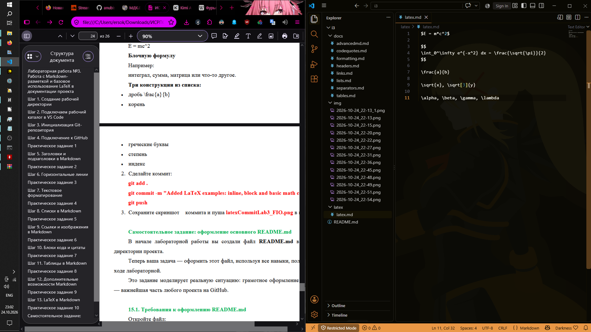

# ISRPO 3

Краткое описание проекта. Данная лабораторная работа посвящена изучению и практическому применению облегченного языка разметки Markdown, а также интеграции математических формул с использованием системы вёрстки LaTeX. Целью работы является освоение инструментов ведения проектной документации, структуры репозиториев на GitHub и базового синтаксиса форматирования текстовых файлов.

**Исполнитель:** Чумаченко Михаил 
**Группа:** ИСП-242

---

## Содержание
1. [Структура проекта](#структура-проекта)
2. [Используемые технологии](#используемые-технологии)
3. [Примеры форматирования](#примеры-форматирования)
4. [Математические формулы LaTeX](#математические-формулы-latex)
5. [Статус выполнения задач](#статус-выполнения-задач)

---

## Структура проекта

Ниже представлено дерево каталогов нашей рабочей директории:

*   **Lab3_MarkdownLaTeX_Leontev/** — корневая директория проекта
    *   `README.md` — главный файл описания (этот файл)
    *   **docs/** — папка для Markdown-файлов лабораторной работы
        *   `headers.md` — примеры заголовков
        *   `separators.md` — примеры разделителей
        *   `formatting.md` — примеры текстового форматирования
        *   `lists.md` — списки задач
        *   `links.md` — ссылки и картинки
        *   `codequotes.md` — блоки кода и цитаты
        *   `tables.md` — таблицы
        *   `advancedmd.md` — чекбоксы и алерты
        *   `latex.md` — математические формулы
    *   **img/** — папка со скриншотами выполнения заданий
       
        
    
---

## Используемые технологии

В ходе выполнения работы были задействованы следующие инструменты:
1. **Редактор кода:** Visual Studio Code (VS Code)
2. **Система контроля версий:** Git и удаленный хостинг GitHub
3. **Языки разметки:** Markdown (разметка текста)[^1] и LaTeX (математические выражения)

[^1]: Markdown — легкий язык разметки, созданный Джоном Грубером для написания максимально читаемого текста.

---

## Примеры форматирования

### Стилизация текста
Текст в документации может быть **полужирным**, *курсивным*, ***жирным курсивом*** или вообще ~~зачёркнутым~~. При необходимости выделить команду внутри текста используется `моноширинный шрифт`.

### Цитата дня
> Разработка программного обеспечения — это не просто написание кода, это создание понятной и доступной документации для будущих поколений разработчиков.
> > Документируйте код весело и с кайфом

### Пример кода (C#)
Ниже представлен код консольного приложения `FormatDemo.cs`, складывающего два числа:

```csharp
// мне лень создавать целую консоль под FormatDemo.cs
Console.Write("Введите первое число: ");
double number1 = Convert.ToDouble(Console.ReadLine());

Console.Write("Введите второе число: ");
double number2 = Convert.ToDouble(Console.ReadLine());


double sum = number1 + number2;

Console.WriteLine(\$"***Результаты операций: {sum}***");


Console.ReadKey();
```

### Сводная таблица команд Git

| Функция | Команда Git | Описание |
| :--- | :---: | ---: |
| Создание репозитория | `git init` | Инициализация нового локального репозитория |
| Просмотр состояния | `git status` | Показывает текущий статус изменённых файлов |
| Отправка на GitHub | `git push` | Загружает локальные коммиты на удаленный сервер |

---

## Математические формулы LaTeX

Markdown поддерживает интеграцию формул. Выражения могут быть строчными (inline), например, закон эквивалентности массы и энергии: $E = mc^2$, либо площадь круга: $S = \pi r^2$.


$$
\sum_{i=1}^n i = \frac{n(n+1)}{2}
$$

$$
\int_0^\infty e^{-x^2} dx = \frac{\sqrt{\pi}}{2}
$$

---

## Статус выполнения задач

- [x] Шаг 1-4: Настройка рабочего пространства, создание папок и первый пуш на GitHub
- [x] Шаг 5-12: Изучение базового и расширенного синтаксиса разметки Markdown
- [x] Шаг 13: Интеграция математических формул LaTeX
- [ ] Шаг 15: Финальное оформление главного README.md проекта


### Скриншот



